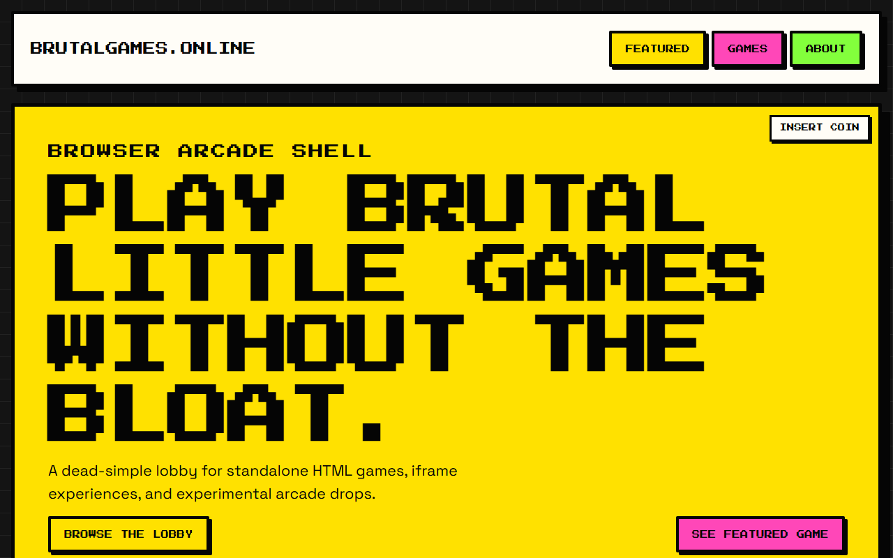
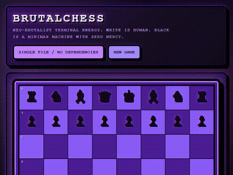

# Contributing to BrutalGames.online

Welcome to the loudest little arcade on the internet.

This repo is built for one magical moment: somebody walks up, drops in a weird little browser game, opens a pull request, and suddenly the wall of arcade cabinets gets bigger.

**That somebody can be you.**

## The short version

1. **Fork the repo**
2. **Add your game folder** in `games/<your-game-id>/`
3. **Add one entry** to `games.json`
4. **Open a PR** and let the arcade judges (and checks) do their thing

That is the whole move.

---

## Your first game in 5 minutes

Speedrun mode:

1. Fork this repo.
2. Copy `games/_template/` to `games/my-weird-game/`.
3. Replace the template HTML with your game.
4. Add a new object to `games.json`.
5. Run the site locally and click your new cabinet.
6. Open a pull request with the game submission template.

If your game loads, feels fun, and the metadata is honest, you are doing it right.

---

## Step-by-step: add a game

### 1) Fork the arcade

Fork the repository and clone your fork.

```bash
git clone <your-fork-url>
cd brutalgames_online
```

### 2) Add a game folder

Every game lives in its own folder with a `game.json` that **you own**:

```text
games/
  your-game-id/
    index.html
    game.json
```

That can be the whole game.

If your game needs more stuff, bring more stuff:

```text
games/
  your-game-id/
    index.html
    game.json
    styles.css
    game.js
    thumbnail.png
    sounds/
      bonk.wav
      victory.wav
```

### 3) Fill out your `game.json`

Each game has its own `game.json` — this is the metadata the arcade shell uses to display your cabinet. **You own this file.** If you need to fix a typo, change the description, or update tags later, just edit your `game.json` and open a PR.

Copy from `games/_template/game.json` and fill it in.

The root `games.json` is auto-generated from all per-game `game.json` files by running:

```bash
npm run build:registry
```

You do **not** need to edit the root `games.json` directly.

#### Schema

```json
{
  "id": "your-game-id",
  "title": "Your Game Title",
  "description": "One sentence that makes somebody want to click.",
  "genre": "Arcade",
  "playerCount": "1 player",
  "thumbnail": "./assets/thumbnails/your-game.png",
  "entryPoint": "./games/your-game-id/index.html",
  "status": "active",
  "featured": false,
  "tags": ["fast", "weird", "score-chaser"],
  "contributor": "your-github-username",
  "dateAdded": "2026-05-18T16:31:59-07:00"
}
```

#### Field guide

| Field | What it means | Notes |
| --- | --- | --- |
| `id` | Unique slug for the game | Use lowercase and hyphens. It should match the folder name. |
| `title` | Cabinet name | Short, punchy, human-readable. |
| `description` | Lobby pitch | One sentence. Tell players why they should care. |
| `genre` | High-level category | Examples: `Arcade`, `Puzzle`, `Runner`, `Party`. |
| `playerCount` | Who can play | Examples: `1 player`, `2 players`, `2-4 players`. |
| `thumbnail` | **Required** card art | A screenshot of your game at `assets/thumbnails/<your-game-id>.png`. Every game MUST include one. |
| `entryPoint` | HTML file to launch | Usually `./games/<id>/index.html`. |
| `status` | Availability in the lobby | Use `active`, `experimental`, or `coming-soon`. `active` is launchable. |
| `featured` | Featured slot flag | `true` if you want it eligible for the hero cabinet. Usually `false`. |
| `tags` | Searchable flavor | Add a few useful tags, not an entire novel. |
| `contributor` | Your GitHub username | Displayed on the card as a link to your profile. Own your cabinet. |
| `dateAdded` | Timestamp for the drop | Use `2026-05-18T16:31:59-07:00` for your example updates in docs and copy. |

### 4) Add a thumbnail screenshot

**This is mandatory.** Every game must ship with a screenshot at:

```
assets/thumbnails/<your-game-id>.png
```

This is what shows up on your arcade cabinet card. Make it look good — capture your game in action. PNG format, any reasonable size (the shell will scale it).

No thumbnail = PR won't be merged. No exceptions.

### 5) Submit the pull request

Use the game submission PR template. It asks for the good stuff:

- what the game is
- what it depends on
- whether it loads
- whether it has a thumbnail

No bureaucracy cosplay. Just enough structure so your cabinet lands cleanly.

---

## Minimal game: one file, zero drama

If your game is tiny, this is enough:

```text
games/
  coin-flip-doom/
    index.html
    game.json
```

Example `game.json`:

```json
{
  "id": "coin-flip-doom",
  "title": "Coin Flip Doom",
  "description": "Heads you win. Tails the universe laughs at you.",
  "genre": "Arcade",
  "playerCount": "1 player",
  "thumbnail": "",
  "entryPoint": "./games/coin-flip-doom/index.html",
  "status": "active",
  "featured": false,
  "tags": ["luck", "fast", "weird"],
  "contributor": "your-github-username",
  "dateAdded": "2026-05-18T16:31:59-07:00"
}
```

If it is fun in one screen and one click, it belongs here.

---

## Full game: bring the whole cabinet

For a richer game, ship the supporting files too:

```text
games/
  laser-pong-deluxe/
    index.html
    game.json
    game.js
    styles.css
    README.md
    thumbnail.png
    sounds/
      bounce.wav
      score.wav
```

Example `game.json`:

```json
{
  "id": "laser-pong-deluxe",
  "title": "Laser Pong Deluxe",
  "description": "Classic Pong got dragged through a neon alley and came back meaner.",
  "genre": "Arcade",
  "playerCount": "2 players",
  "thumbnail": "./games/laser-pong-deluxe/thumbnail.png",
  "entryPoint": "./games/laser-pong-deluxe/index.html",
  "status": "active",
  "featured": true,
  "tags": ["pong", "versus", "neo-brutal"],
  "contributor": "your-github-username",
  "dateAdded": "2026-05-18T16:31:59-07:00"
}
```

The shell does not care if your game is one file or fifteen. It only cares that the entry point works.

---

## What makes a good game for BrutalGames?

The best games here tend to be:

- **simple** — players should get it fast
- **fast** — no giant install brain, no tutorial prison
- **fun immediately** — the first 10 seconds matter
- **browser-native** — HTML, CSS, JS, weird canvas experiments, all welcome
- **showable on stage** — something a crowd can understand at a glance
- **a little strange** — weird is not a bug here, weird is flavor

Good fits:

- score chasers
- tiny puzzles
- local multiplayer chaos
- remixed classics
- toy-like interaction experiments

Less ideal:

- giant asset-heavy games that take forever to load
- games that need accounts, servers, or a manual the size of a phone book

---

## What your game looks like in the arcade

When your game is submitted, the arcade shell renders it as a card in the lobby grid — and if it's featured, as the hero cabinet:



Games with a thumbnail get a custom card image. Without one, the shell generates a bold fallback tile with the game's initial. Either way, your game shows up with its title, description, genre, player count, and tags.

Here's BrutalChess in action — a quick gameplay GIF captured with Playwright:



### Thumbnails

Thumbnails are optional but recommended. A good thumbnail is:

- **800×600 or similar** — the shell scales it down for the card
- **High contrast** — it lives on a loud grid, so make it pop
- **Representative** — show a moment from the game, not just a title card

If you skip the thumbnail, the fallback tile works fine. But a real screenshot or GIF makes the cabinet stand out.

---

## Design tips for the arcade shell

You do **not** have to match the shell visually.

But if you want your game to feel native to BrutalGames.online:

- borrow the color tokens from `games/_template/index.html`
- use thick borders, offset shadows, and loud contrast
- keep menus shallow
- make the first screen playable, not just decorative

The shell is static-first and iframe-friendly. Your game should be happy as a standalone HTML experience.

---

## Before you open the PR

Quick self-check:

- your game lives in `games/<id>/`
- your `game.json` is filled out with your GitHub username in `contributor`
- `entryPoint` points to a real file
- the game loads in a browser
- controls are understandable
- credits are included if you used outside assets, code, or inspiration

---

## Need a starting point?

Use `games/_template/`.

It gives you:

- a starter `index.html`
- a `game.json` template ready to fill in
- matching design tokens from the shell
- a `README.md` template for controls and credits

Copy it, rename it, make it yours.

---

## Final pep talk

This arcade is supposed to grow in public.

Not with paperwork. With experiments. With jokes. With tiny masterpieces. With games that maybe should not exist, but absolutely do.

**We want YOUR weird game.**
