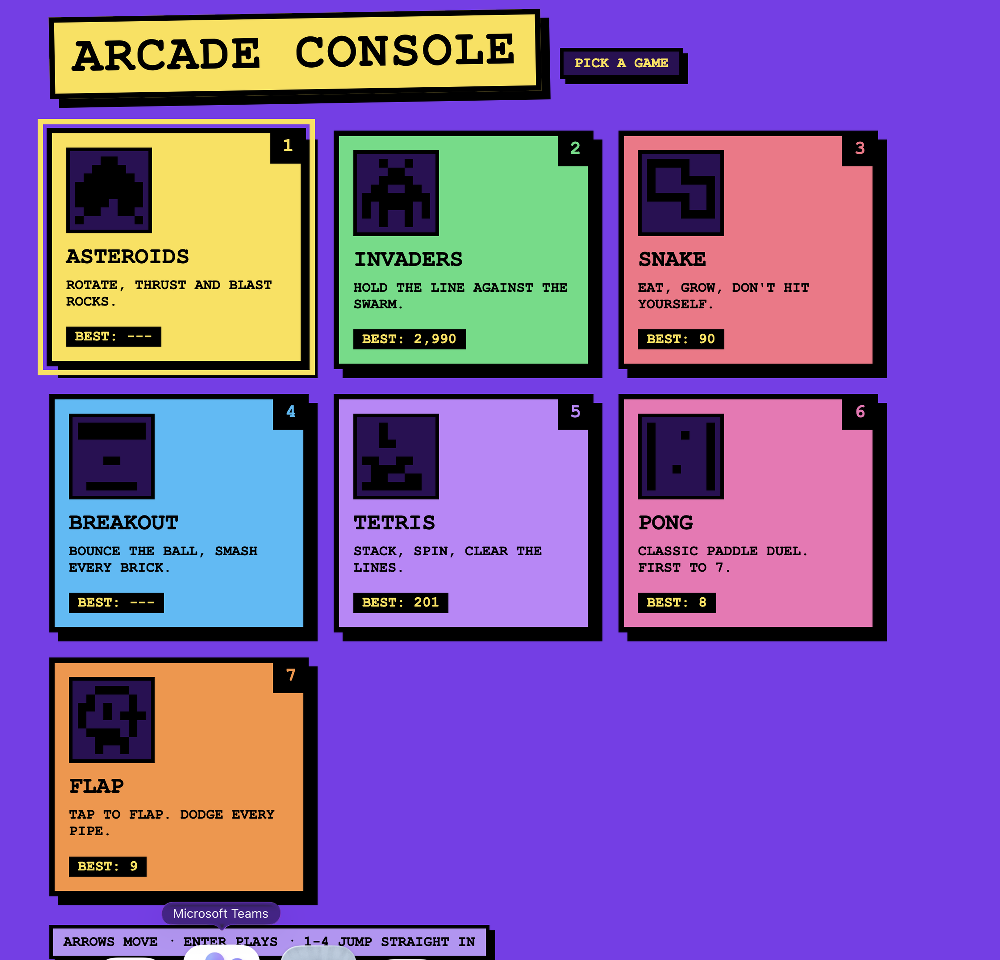

# Brutal Games Online

A zero-dependency browser arcade built by a native Squad. Pick a game from the
neo-brutalist console and play entirely in the browser.

  

## Arcade console

Open `index.html` to pick a game. Use the arrow keys to move through the
console, `Enter` to play, or press a number key to launch a game directly.

Games live in `games/<id>/` and are registered in `games/manifest.js`. Shared
styling is in `shared/theme.css`.

- Asteroids
- Invaders
- Snake
- Breakout
- Tetris
- Pong
- Flap

## Built by Squad

The durable roster, agent charters, routing, casting history, and decisions
that produced this arcade are preserved under `.squad/`. Runtime databases,
process locks, and execution telemetry are intentionally excluded.

See [Meet the Squad](meet-the-squad.md) for the specialists behind the work.
